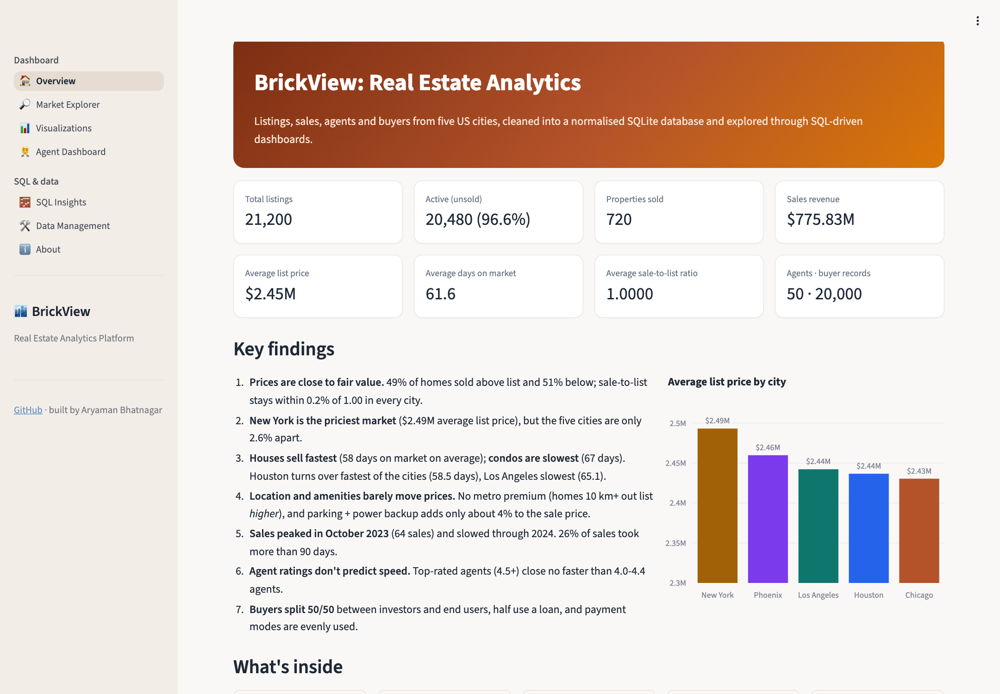
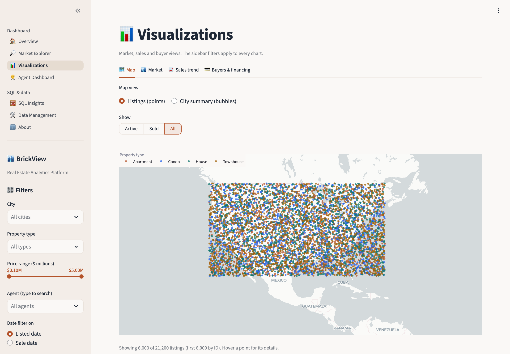
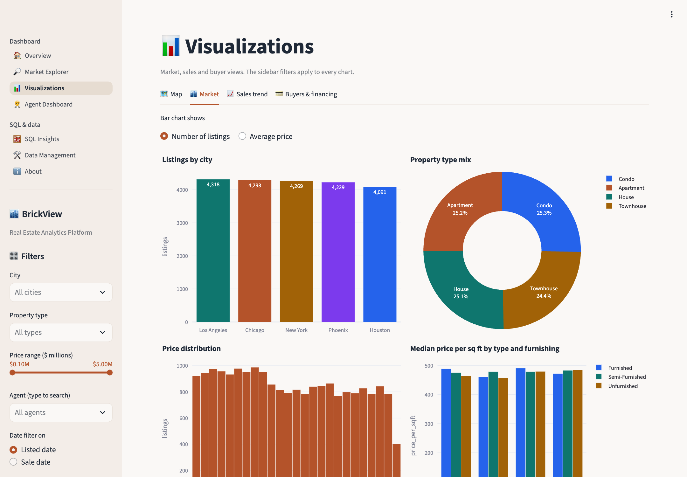
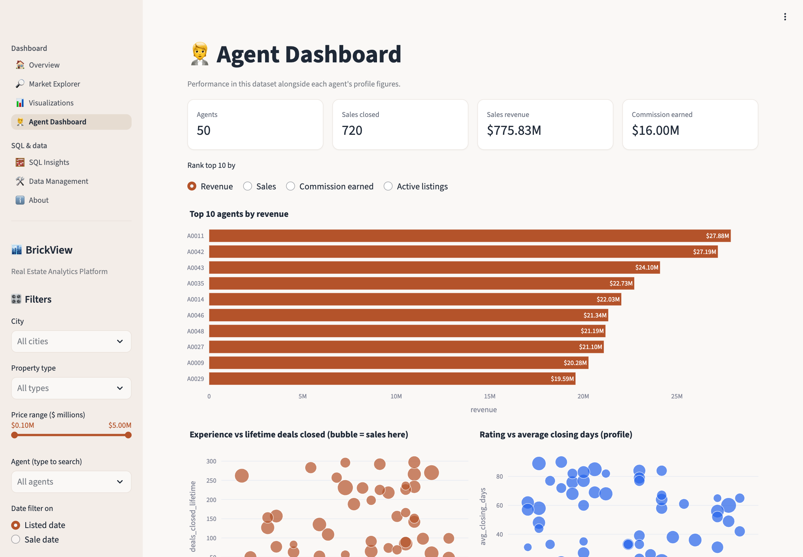
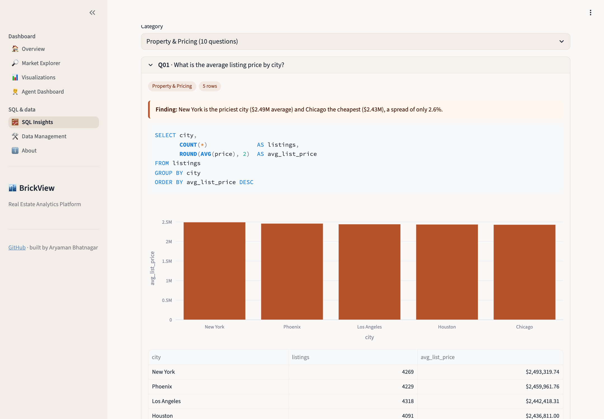
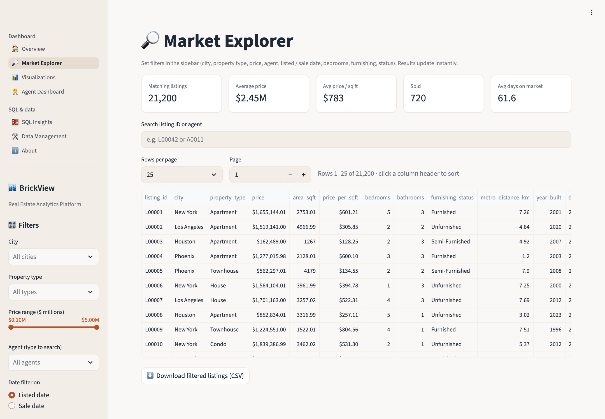
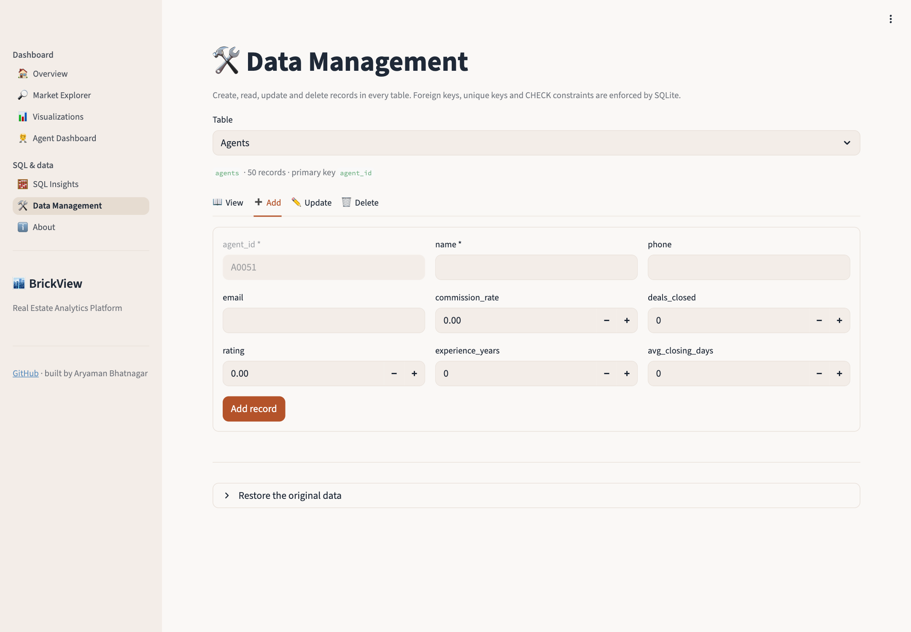

# BrickView: Real Estate Analytics Platform

[](https://brickview-real-estate.streamlit.app)


A SQL-driven real-estate dashboard. Five raw files (21,200 listings, their attributes, 50 agents, 720 sales and
20,000 buyer records across five US cities) are cleaned with **Python**, stored in a normalised **SQLite**
database with constraints, indexes and views, analysed with **30 SQL queries**, and explored in a
**Streamlit** app with filters, an interactive map, charts, an agent dashboard and full CRUD.

**Live app:** https://brickview-real-estate.streamlit.app  
**Project report:** [`reports/BrickView_Project_Report.pdf`](reports/BrickView_Project_Report.pdf)  
**Analysis notebook:** [`notebooks/eda.ipynb`](notebooks/eda.ipynb)



## Key findings

1. **Prices are close to fair value.** 49% of homes sold above list and 51% below; the sale-to-list ratio is
   within 0.2% of 1.00 in every city.
2. **New York is the most expensive city** ($2.49M average list price), but the five cities are only 2.6% apart.
3. **Houses sell fastest** (58 days on market) and **condos slowest** (67 days). Houston is the fastest market
   (58.5 days), Los Angeles the slowest (65.1).
4. **Location and amenities barely move prices.** There's no metro premium, furnishing adds about 1%, and
   parking + power backup adds about 4% to the sale price.
5. **Sales peaked in October 2023** (64 sales) and slowed through 2024; 26% of sales took more than 90 days.
6. **Agent ratings don't predict closing speed**, and experience is only weakly linked to deals closed.
7. **Buyers split 50/50** between investors and end users; about half take a loan, in every city.

## The app

| Page | What it does |
|---|---|
| **Overview** | KPIs, key findings, city price chart |
| **Market Explorer** | Sidebar filters: city (multi-select), property type, price range slider, agent (searchable), listed **or** sale date range, status, bedrooms, furnishing. Paged, sortable table with search and CSV download |
| **Visualizations** | Interactive map of listings (hover for city, price, coordinates) plus a city-summary bubble map; listings / average price by city; property-type pie; price distribution; monthly new listings vs sales; days on market; sale-to-list ratio; buyers and financing |
| **Agent Dashboard** | Top-10 leaderboard (revenue, sales, commission, active listings), experience vs deals, rating vs closing time, a profile and sales list for any agent |
| **SQL Insights** | All 30 questions in drop-downs: each shows the SQL, its live result, a chart and the finding. Also a read-only box to run your own `SELECT` |
| **Data Management** | Create, read, update and delete for **all five tables**, with forms built from the schema, foreign-key / unique / CHECK errors shown in plain English, a cascade warning before deletes, and a one-click restore |
| **About** | Schema diagram, cleaning log, data notes |

The sidebar filters build one parameterised SQL `WHERE` clause over the `v_listing_details` view, so every
KPI and chart on the Explorer, Visualizations and Agent pages is a fresh SQLite query.

| | |
|---|---|
|  |  |
|  |  |
|  |  |

## Database

```
agents 1 ──< listings 1 ── 1 property_attributes
                  1
                  └── 0..1 sales 1 ──< buyers
```

- **5 tables** with primary keys, enforced foreign keys (`ON DELETE CASCADE`, `SET NULL` for a deleted agent),
  `UNIQUE` one-to-one links (one attribute row and at most one sale per listing), and `CHECK` constraints on
  prices, ratings, dates, flags and categories.
- **10 indexes** on every join and filter column (city, type, agent, price, dates, buyer → sale).
- **6 views**: `v_listing_details`, `v_active_listings`, `v_sale_details`, `v_buyer_details`,
  `v_agent_performance`, `v_city_summary`.

Source: [`sql/schema.sql`](sql/schema.sql). As stored by SQLite: [`sql/schema_dump.sql`](sql/schema_dump.sql).

## SQL analysis

All 30 questions from the brief are in [`sql/queries.sql`](sql/queries.sql), grouped as **Property & Pricing**
(Q01-Q10), **Sales & Market** (Q11-Q18), **Agent Performance** (Q19-Q25) and **Buyer & Financing** (Q26-Q30).
They use joins, `CASE` banding, subqueries, `NOT EXISTS`, CTEs and window functions (`ROW_NUMBER`, `RANK`, and a
true median). The app, the notebook and the report all read this one file, and the tests check key answers
against pandas.

## Data cleaning and data notes

[`src/clean.py`](src/clean.py) logs every step to [`data/processed/cleaning_log.csv`](data/processed/cleaning_log.csv).
Cleaned tables are saved as CSV in [`data/processed/`](data/processed/).

- Column names standardised; prices and areas rounded; dates to `YYYY-MM-DD`; booleans to 0/1.
- `buyers.sale_id` in the raw file actually holds **listing IDs**; it is mapped to the real `sales.sale_id`.
- `days_on_market` was a noisy float equal to the listing-to-sale date gap (within 0.03 days); stored as whole days.
- 255 rows with `floor_number > total_floors` were swapped.

The dataset is synthetic coursework data, and some quirks can't be fixed, only flagged:

- **Coordinates don't match cities.** Every city's listings are spread over the whole continental US, so the
  listings map shows them as given and the city-summary map uses real city centres.
- **Two listing populations.** Only L00001-L01200 have sales ($0.1M-2M). The other 20,000 listings reach $5M and
  none are sold, so average sale prices ($1.08M) are far below average list prices ($2.45M).
- **Buyers:** 20,000 records for 720 sales (about 28 per sale), and 93% of loans exceed the sale price.
- **Agents:** `deals_closed` is a lifetime figure (average 137), not the sales in this data (average 14).
- **Currency:** US cities, so values are shown in US dollars.

## Project structure

| Path | Purpose |
|---|---|
| `config.py` | Paths, domain values, price buckets, links |
| `pipeline.py` | Raw files → cleaned CSVs → SQLite database → runs the 30 queries as a check |
| `src/clean.py` | Per-table cleaning with a change log |
| `src/db.py` | Connections (foreign keys on), database build, integrity check, `queries.sql` parser |
| `sql/schema.sql` · `sql/queries.sql` | Schema, indexes and views · the 30 business queries |
| `app/streamlit_app.py` | Entry point: navigation and sidebar filters |
| `app/views.py` · `app/data.py` · `app/ui.py` | Pages · cached queries, filter → `WHERE` builder, CRUD · styling and chart helpers |
| `notebooks/eda.ipynb` | Raw-data profiling, cleaning, all 30 questions answered, key insights |
| `tests/test_brickview.py` | 43 tests: counts, integrity, schema, all queries, answers vs pandas, filters, CRUD, cascades |
| `reports/` | Project report (PDF), screenshots, figures, and the scripts that build them |
| `data/raw/` · `data/processed/` · `db/` | Provided files · cleaned CSVs · the SQLite database |

## Run it locally

```bash
git clone https://github.com/aryaman2213/BrickView-Real-Estate-Analytics-Platform.git
cd BrickView-Real-Estate-Analytics-Platform
pip install -r requirements.txt

python pipeline.py                 # rebuild the cleaned CSVs and db/brickview.db (optional: both are committed)
streamlit run app/streamlit_app.py # http://localhost:8501
pytest -q                          # 43 tests
```

The build is deterministic: rerunning `pipeline.py` produces a byte-identical database.

## Deploy on Streamlit Community Cloud

1. Sign in at [share.streamlit.io](https://share.streamlit.io) with GitHub and choose **Create app → Deploy a public app from GitHub**.
2. Repository `aryaman2213/BrickView-Real-Estate-Analytics-Platform`, branch `main`, main file `app/streamlit_app.py`.
3. Under **Advanced settings**, pick Python 3.13. Dependencies come from `app/requirements.txt`.
4. Set a custom subdomain (e.g. `brickview-real-estate`) and deploy.

CRUD changes on the cloud app persist until the app restarts; **Data Management → Restore the original data**
resets them at any time.

## Tech stack

Python · pandas · SQLite · SQL (views, indexes, CTEs, window functions) · Streamlit · Plotly · pytest · Jupyter

## Author

**Aryaman Bhatnagar** · [aryamanbhatnagar2273@gmail.com](mailto:aryamanbhatnagar2273@gmail.com) · [GitHub](https://github.com/aryaman2213)

## License

[MIT](LICENSE)
